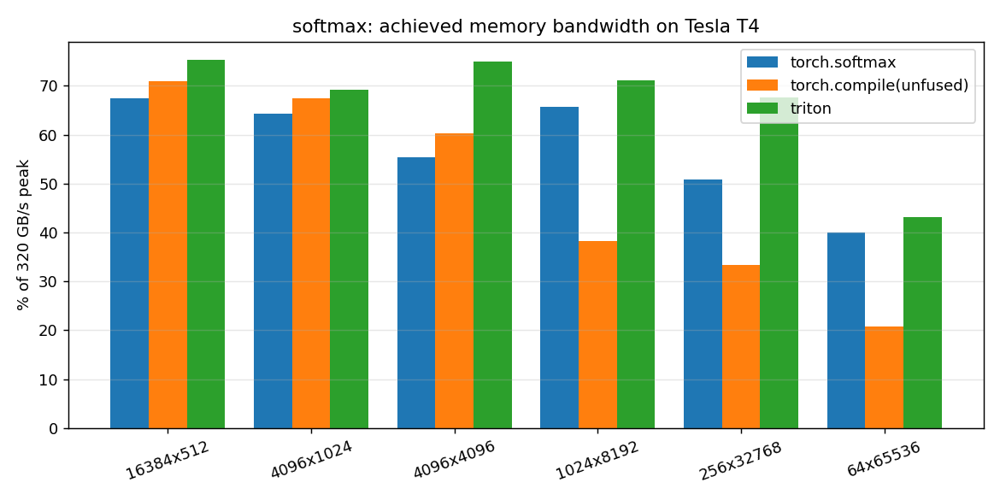
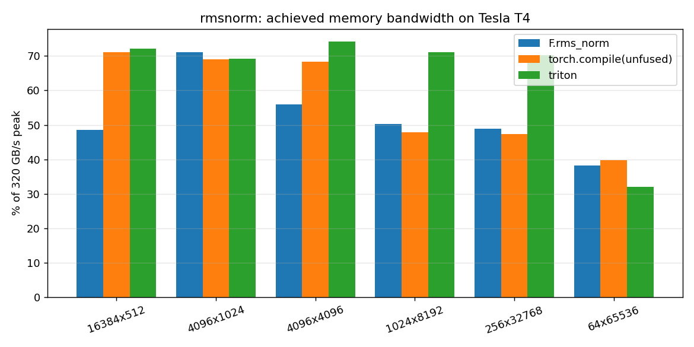

# fusedkernels

Fused softmax and RMSNorm kernels written in Triton from scratch, benchmarked against PyTorch baselines, with a step-by-step walkthrough.

Project 7 of 15 in [inference-infra-portfolio](https://github.com/NomanJafar/inference-infra-portfolio).

## What this builds

Write fused softmax and RMSNorm kernels in Triton and benchmark them against the PyTorch baselines across shapes.

## Why it matters

Kernel intuition separates infra engineers from API callers.

## Status

Done. Correctness is proven on CPU under Triton's interpreter (46 tests); the bandwidth numbers below were measured on a Kaggle T4 on 11 Oct 2026.

## What is in here

| Module | Purpose |
|---|---|
| `fusedkernels.softmax` | Row-wise fused softmax: one program per row, whole row in one block, masked loads with `-inf`, FP32 accumulation |
| `fusedkernels.rmsnorm` | Row-wise fused RMSNorm: one read, one write, FP32 accumulation so `x^2` cannot overflow FP16 |
| `fusedkernels.reference` | The unfused PyTorch versions (3-4 passes), used as the `torch.compile` baseline |
| `fusedkernels.bench` | Six shapes x three implementations, median time with L2 flushed, achieved GB/s and % of the T4's 320 GB/s |
| `fusedkernels.plots` | Bandwidth-vs-shape bar charts |

## Running the tests

Triton has no macOS wheels, so the kernel tests run in a Linux container under `TRITON_INTERPRET=1` (exact, slow) or on a GPU:

```bash
./scripts/test-cpu.sh              # builds a small python:3.12 image with torch (CPU) + triton, runs pytest
pytest                             # on a Linux box with triton installed, or on a GPU
```

Tests cover power-of-two and ragged row lengths (1, 7, 100, 1025, ...), FP16 and FP32, large-input stability, non-contiguous inputs, and explicit block-size overrides.

## Benchmark

```bash
python -m fusedkernels.bench --out results/bench.json      # GPU only
```

`notebooks/kaggle_fusedkernels.ipynb` runs the tests on the GPU, the benchmark, and a block-size / `num_warps` sweep on one shape.

## Results (Tesla T4, FP16, Kaggle, 2026-10-11)

All 46 tests pass on the GPU (torch 2.11.0+cu128, triton 3.6.0 on the Kaggle image). Achieved bandwidth in GB/s and as a fraction of the T4's 320 GB/s, median of 100 runs with the L2 cache flushed between runs (`triton.testing.do_bench`). Raw data: [`results/kaggle_run1/bench.json`](results/kaggle_run1/bench.json).

**Softmax**

| shape (rows x cols) | torch.softmax | torch.compile (unfused) | **Triton** |
|---|---|---|---|
| 16384x512 | 216 (67%) | 227 (71%) | **241 (75%)** |
| 4096x1024 | 206 (64%) | 216 (67%) | **221 (69%)** |
| 4096x4096 | 177 (55%) | 193 (60%) | **240 (75%)** |
| 1024x8192 | 210 (66%) | 122 (38%) | **228 (71%)** |
| 256x32768 | 163 (51%) | 107 (33%) | **217 (68%)** |
| 64x65536 | 128 (40%) | 66 (21%) | **138 (43%)** |

**RMSNorm** (weight vector read counted once)

| shape (rows x cols) | F.rms_norm | torch.compile (unfused) | **Triton** |
|---|---|---|---|
| 16384x512 | 155 (49%) | 228 (71%) | **231 (72%)** |
| 4096x1024 | 227 (71%) | 221 (69%) | **221 (69%)** |
| 4096x4096 | 179 (56%) | 219 (68%) | **237 (74%)** |
| 1024x8192 | 161 (50%) | 153 (48%) | **228 (71%)** |
| 256x32768 | 156 (49%) | 151 (47%) | **225 (70%)** |
| 64x65536 | 122 (38%) | 127 (40%) | **103 (32%)** |




**Block size on 4096x4096 softmax** (the row needs 4096; larger blocks only add masked lanes):

| BLOCK | num_warps | ms | GB/s |
|---|---|---|---|
| 4096 | 16 | 0.307 | 218 |
| 8192 | 16 | 0.381 | 176 |
| 16384 | 16 | 0.476 | 141 |

### What the numbers say

1. **Fusion is the whole game, and ~70–75% of peak is the ceiling for a simple row kernel here.** The Triton kernels sit at 67–75% of 320 GB/s on five of six shapes. That is one read and one write of the matrix, with the remaining gap being launch overhead, the tail of partially filled SMs, and DRAM efficiency; nobody gets 100%.
2. **The hand-written kernel beats `torch.softmax` by 5–35%, most at 4096x4096 (240 vs 178 GB/s).** PyTorch's kernel is tuned for generality (any dtype, any dim, backward support); a single-purpose row kernel has less to do. It is not a sign that PyTorch is slow in general.
3. **`torch.compile` of the unfused expression fuses well for short rows and falls apart for long ones** (38%, 33%, 21% of peak for 8k, 32k, 64k columns on softmax). The generated kernel evidently splits the reduction and round-trips through memory. Fusion by a compiler is not guaranteed to be fusion.
4. **The single-block design has a cliff.** At 64x65536 every implementation drops (only 64 program instances for 40 SMs, and a 65k-element block per instance), and the Triton RMSNorm falls *below* PyTorch (102 vs 122 GB/s): the block no longer fits in registers and spills. This is the case the primer flagged, and the fix is the online/chunked variant, which is the natural next step.
5. **An oversized block costs real bandwidth.** 4096 -> 8192 -> 16384 on a 4096-wide row goes 218 -> 176 -> 141 GB/s: the masked lanes are still loaded (as fill), still reduced, and still occupy registers. `next_power_of_2(n_cols)` is the right default; "bigger is safer" is wrong for row kernels.
6. **Run-to-run noise is about 10%.** The same 4096x4096 softmax measured 240 GB/s in the main sweep and 218 GB/s in the block sweep a minute later. Differences under that size in the tables above are not differences.

### What was not measured

Backward passes; shapes beyond 64k columns; `num_warps` as an independent variable (it tracked block size here); any GPU other than the T4. FP32 inputs were tested for correctness but not timed.

## Layout

```
CONCEPTS.md     the theory behind the project, written before the code
src/fusedkernels/   implementation
tests/          CPU-only tests, runnable on a laptop
notebooks/      GPU notebooks (Kaggle / Colab) that run the experiments and write results/
results/        measured numbers and plots
```

## Running

```bash
python -m venv .venv && source .venv/bin/activate
pip install -e ".[dev]"
pytest
```

GPU experiments run from `notebooks/`; each notebook clones this repo, installs it and writes its outputs to `results/`.

## Hardware notes

Developed against free-tier GPUs (Kaggle and Colab T4, 16 GB). Where a T4 limits what can be measured (no FP8, Turing-era kernels), the README says so rather than papering over it.

## License

MIT
